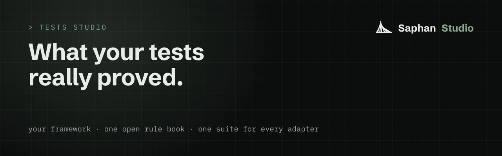

# Tests Studio

<p align="center"></p>


**Tests Studio shows what your tests really proved, in the test framework you already use.**
It is for any team whose code, and whose tests, now arrive faster than people can check them, often written by AI
agents. You do not need to know anything about Saphan to read this page or to use what is in it.

## The problem

A run that says "42 passed" is easy to produce and hard to trust.

- **A green run can prove the wrong thing.** An agent fixes a bug and adds ten tests. All ten pass. Take the fix out and
  run them again: all ten still pass. They were testing something else. A test that passes with the fix removed proves
  nothing about the fix, and the run does not tell you which kind of test you have.
- **Results are scattered.** pytest reports in one shape, Playwright in another, Go tests in a third. Each framework needs
  its own reporter, and there is no one place that shows what ran and what the system did while it ran.
- **An AI verdict usually leaves no record.** To have a model judge a run, a team puts its own API key into its test
  code and gets back an opinion. Nothing records what the model was shown, which model it was, or why it decided.

## Try it first (5 minutes)

You need Go 1.26 or newer. No account, no key, and no network after the download.

Four words, so the commands make sense. A **test run** is one go of your tests; each test in it is a **step**. An
**adapter** is a small plug-in inside a test framework that reports every step. The **conformance suite** plays the
part of Tests Studio, watches every call an adapter makes, and says whether each call follows the rules.

Get the code:

```
git clone https://github.com/saphan-ai/tests-studio
cd tests-studio
```

Build the suite and the tiny adapter that comes with it, then let the suite judge that adapter. The adapter runs a
sample project of four tests: one passes, one fails, one is skipped, and one never gets to run.

```sh
go -C conformance build -o ../bin/tests-conformance ./cmd/tests-conformance
go -C conformance build -o ../bin/sample-adapter ./cmd/sample-adapter
./bin/tests-conformance --items 4 --mode standalone -- ./bin/sample-adapter --project conformance/testdata/sample-project/tests.json  # needs: listener
./bin/tests-conformance --items 4 --mode leg -- ./bin/sample-adapter --project conformance/testdata/sample-project/tests.json  # needs: listener
```

The suite starts two small stand-in servers on your own machine (address `127.0.0.1`), so it needs permission to
listen there. Nothing leaves your machine. The second run checks the same adapter joining a run that someone else opened.

What you will see: one line per rule, fifteen in all, a summary, and exit code 0. Measured on 2026-10-30 on an
Apple-silicon Mac (abridged):

```text
PASS spec-version-known — asked GET /v1/spec (call 1), then declared "v1", which the core serves (v1)
PASS traceparent-to-sut — 2 requests reached the system under test, each with exactly the traceparent and baggage the core handed out
PASS run-result-counts — counts {Total:4 Passed:1 Failed:1 Errored:1 Skipped:1} equal the steps the core saw, and verdict "error" follows from them
PASS mock-control-bypass — 29 calls observed, none to a mock's own URL; 2 went through the Mocks Studio core
SUMMARY 15 checks, 15 passed, 0 failed (standalone mode)
```

If your machine forbids listening on `127.0.0.1`, the suite says so and stops with exit code 4 before any check. The
other exit codes: 1 a check failed, 2 the adapter asked for a version that is not served, 3 the adapter could not start or never reached the suite.

## How it works

This is what works today, in this repository.

1. **Your tests stay in your framework.** An adapter sits inside it and reports every test. The adapter for Go tests is
   here.
2. **One open rule book.** Every adapter follows the same published specification, so a run looks the same at the other
   end, whichever framework produced it.
3. **Every step is tied to what really happened.** Each step gets a short trace tag (the W3C `traceparent` header). The
   test passes it to the program under test, which passes it on, and the mocks standing in for its neighbours record
   it. The run's result carries a fingerprint of everything the mocks recorded, so anyone can fetch it and check it
   again. A mismatch is a refusal, never a pass.
4. **One suite judges every adapter.** It prints `PASS` or `FAIL` for each rule. The suite is held to its own standard:
   deliberately broken copies of its sample adapter, each breaking one rule, must each fail exactly one check.

Tests Studio is one of three parts of one platform: Saphan Studio's agents write the code, Mocks Studio supplies the
mocks, and Tests Studio runs the tests and gives the verdict.

## What is in this repository

| path | what it is |
|---|---|
| [`spec/TEST_RUNNER_V1.md`](spec/TEST_RUNNER_V1.md) | the rule book for adapters (document 1.2, wire version `v1`), with every refusal |
| [`spec/runner-v1.openapi.yaml`](spec/runner-v1.openapi.yaml), [`spec/schemas/`](spec/schemas) | the same calls as OpenAPI 3.1; events and run results as JSON Schema |
| [`conformance/`](conformance) | the conformance suite, its sample adapter and the four-test sample project |
| [`adapters/go-test/`](adapters/go-test) | `tests-go-test`, the adapter for Go tests |
| [`spec/TOOL_RECORD_V1.md`](spec/TOOL_RECORD_V1.md) | a one-file description of how an outside tool (a linter, a secret scanner) is run and what its result means, with its checker `tool-conformance` |
| [`docscheck/`](docscheck) | the test that keeps this page honest: its commands run, its numbers are recomputed |

## See a real example

Real Go tests, through the Go adapter, judged by the same suite. Run this after "Try it first":

```sh
go -C adapters/go-test build -o ../../bin/tests-go-test ./cmd/tests-go-test
(cd adapters/go-test && ../../bin/tests-conformance --items 4 --mode standalone -- ../../bin/tests-go-test ./testdata/sample)  # needs: listener
```

It passes when every check prints `PASS` and the exit code is 0. Your own tests stay plain Go tests; the helper package
`tracectx` puts each step's trace tag on your test's requests. Details: [`adapters/go-test/README.md`](adapters/go-test/README.md).

## Make your test framework report to Tests Studio

1. Read [`spec/TEST_RUNNER_V1.md`](spec/TEST_RUNNER_V1.md). It is written for someone who has never seen our code.
2. Write the adapter in your framework's own language. There is no library to link: the rules are the product.
3. Make a sample project with a passing, a failing and a skipped test. At least one test calls the stand-in program at
   `$TESTS_CONFORMANCE_SUT_URL` with the `traceparent` and `baggage` headers its step was given.
4. Run the suite against your adapter, once in each mode:

```sh
./bin/tests-conformance --items 4 --mode standalone -- <your adapter command> <its arguments>  # needs: adapter
./bin/tests-conformance --items 4 --mode leg -- <your adapter command> <its arguments>  # needs: adapter
```

`--items` is the number of tests in your sample project. If your framework can only report after the run (from a JUnit
XML file, say), add `--profile import`. If the adapter needs an extra environment variable, name it with `--pass-env`.

5. **Your adapter is accepted when every check passes in both modes.** To have it listed here, see [`CONTRIBUTING.md`](CONTRIBUTING.md).

## What it will be

- **More adapters**: pytest (with Appium, for phone apps) and Playwright, judged by the same suite as the Go adapter.
- **The Tests Studio core, in Saphan Studio**: runs on a schedule or on demand, every result and every piece of evidence
  kept, live progress, and mocks set up for each run through Mocks Studio.
- **AI helpers on your own model subscription**: they plan tests, explore the app, explain failures and write the
  report, and every call they make is recorded.
- **A passing run as proof that work is done**: checked by its fingerprint, by anyone, later.

## How it will be built

In small steps. An adapter is added to this repository only when the conformance suite passes against it in both
modes, and is listed here only then. The core stays closed and lives in Saphan Studio; this repository stays enough on
its own to write and check an adapter. When a part lands, it moves from this section to "How it works".

## What is measured

Each number below is recomputed from its command by the documentation check on every run; if the specification changes and the number does not, that check goes red. Measured 2026-10-30 on the commit this page was written against.

- **15** checks the suite runs against an adapter: `sed -n '/^\*\*Checks\*\*/,/^\*\*Mutants/p' spec/TEST_RUNNER_V1.md | grep -c '^| [^ a-z|][a-z0-9-]*[^ a-z|] |'`
- **18** mutants of the sample adapter, each breaking one rule and failing exactly one check: `sed -n '/^\*\*Mutants/,/^## 13/p' spec/TEST_RUNNER_V1.md | grep -c '^| [^ a-z|][a-z0-9-]*[^ a-z|] |'`
- **20** refusal reason codes the specification names for the core: `sed -n '/Reason codes of the Tests Studio core/,/^A call made/p' spec/TEST_RUNNER_V1.md | grep -o '[^ a-z|][a-z]*-[a-z-]*[^ a-z|]' | wc -l`
- **4** tests in the sample project (pass, fail, skip, and one whose body never runs): `grep -c '"outcome"' conformance/testdata/sample-project/tests.json`

What is not here, because it is not measured on this page: how fast the suite runs, and how many adapters pass it.

## Honest limits

Updated with every push to this repository. Last read against the tree on 2026-11-02.

- **There is no public core yet.** The suite plays the core. A pass shows an adapter follows the rules, not that it
  works against the real core, or that it reports your framework's results correctly.
- **The Go adapter runs each test on its own**, so budget about a second per test. Its README gives the measured cost.
- **The `import` profile cannot tie a step to the program under test**: the test has already run. The suite cannot
  check which profile an adapter really uses, so a claim of conformance names its profile.
- **The suite needs to listen on `127.0.0.1`.** Where that is denied it exits 4. In CI, set
  `TESTS_CONFORMANCE_REQUIRE_SOCKETS=1` so a skipped measurement fails instead of passing quietly.
- **On Windows a timeout stops only the adapter itself**; a test worker it started can outlive the run.
- **`tool-conformance` does not fence in the tool it runs** and does not watch its network.
- **Specification v1 only.** A new optional field keeps `v1`; a new required field, a removed one or a changed meaning is `v2`.

## Built in public

The rule book and its suite are public so that anyone can write an adapter and know, without asking us, whether it is
right. They were written and reviewed in Saphan Studio, under a human owner. Every weakness found in the suite, and the
commit that fixed it, is in [`SECURITY.md`](SECURITY.md). Questions go to the issue tracker; a vulnerability goes to the
private channel in [`SECURITY.md`](SECURITY.md), never to a public issue.

## Repository layout

The table under "What is in this repository" names every top-level part. Inside them: `conformance/cmd/` holds
`tests-conformance`, `sample-adapter` and `tool-conformance`; `conformance/internal/` the harness, the stand-in servers
and the checks; `conformance/testdata/` the sample project and the tool fixtures; `spec/ecosystem-v1/` copies of the
contract shared with Mocks Studio (do not edit).

## Documentation

The two specifications ([`spec/TEST_RUNNER_V1.md`](spec/TEST_RUNNER_V1.md), [`spec/TOOL_RECORD_V1.md`](spec/TOOL_RECORD_V1.md)),
the Go adapter ([`adapters/go-test/README.md`](adapters/go-test/README.md)), what the suite treats as untrusted and how to
report a vulnerability ([`SECURITY.md`](SECURITY.md)), and how to add an adapter ([`CONTRIBUTING.md`](CONTRIBUTING.md)).

## For technical readers

The suite is the Go module `github.com/saphan-ai/tests-studio/conformance` (dependencies: a JSON Schema validator and a
YAML reader). The adapter runs as a child process in its own process group, with a scrubbed environment, bounded by
`--timeout` (default 120 seconds). A check of something the adapter must do fails when there is nothing to measure; a
check of something it must not do passes only after counting the calls it looked at.

```sh
go -C conformance test ./... -count=1
go -C docscheck test ./... -count=1  # needs: self
```

## Licence

The code (`conformance/`, `adapters/`, `docscheck/`) is Apache-2.0: see [`LICENSE`](LICENSE). The documents and the
specification (`README.md`, `SECURITY.md`, `CONTRIBUTING.md`, `spec/`, including the copies under `spec/ecosystem-v1/`)
are CC BY 4.0: see [`LICENSE-docs`](LICENSE-docs).
